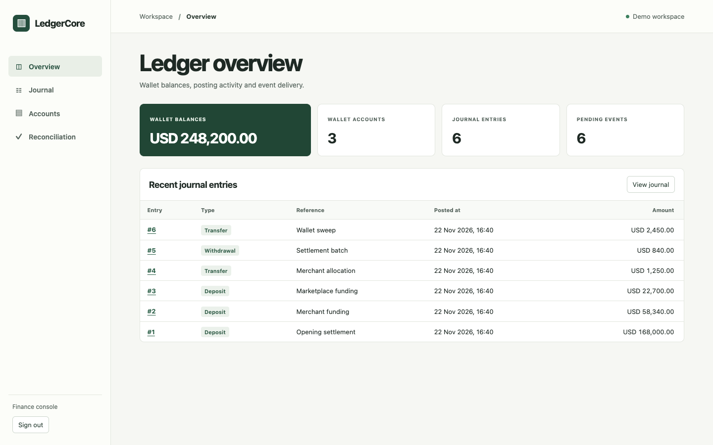
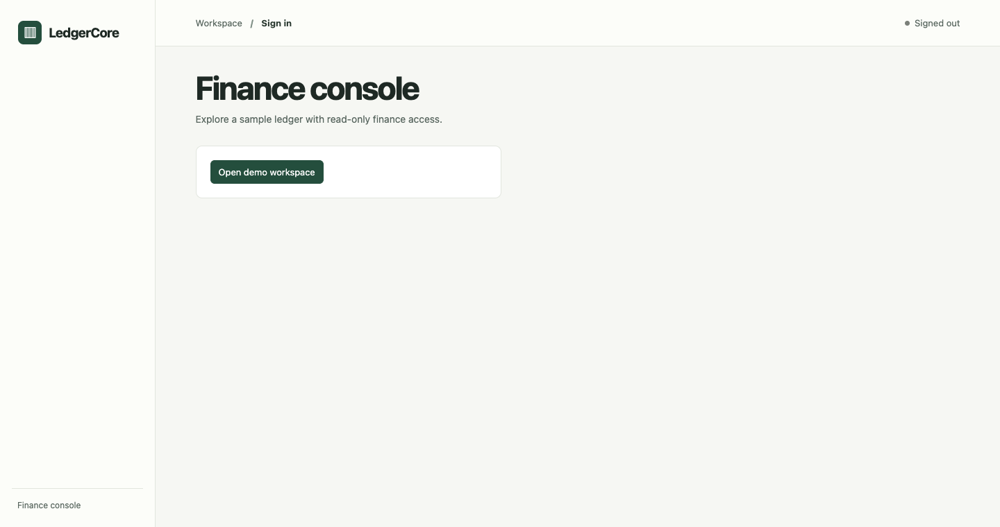
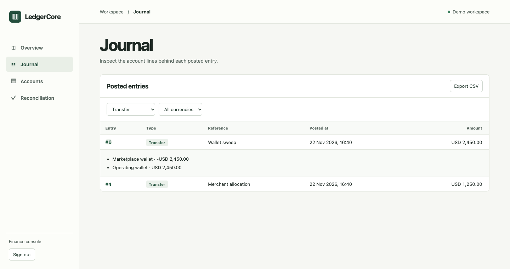
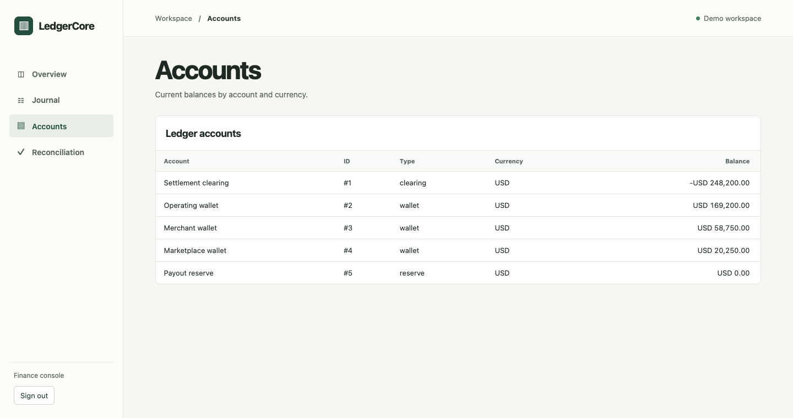
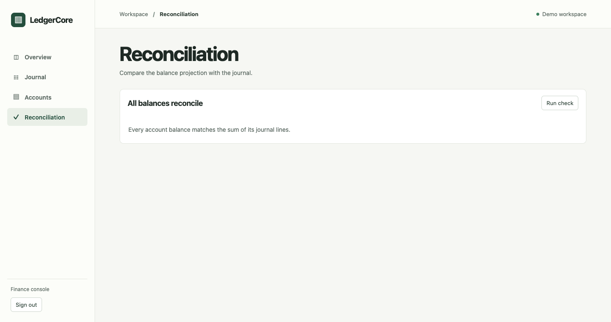

# LedgerCore

LedgerCore records deposits, withdrawals, transfers, and payouts for a small digital wallet. Backend services post those movements through the API. In the finance console, you can check balances against the journal, open an entry to see which accounts it affected, and export the journal as CSV.

Each movement creates a double-entry record whose signed amounts add up to zero. If a transfer times out, the caller can send the same request with the same idempotency key. If the transfer already went through, LedgerCore returns the original entry.



## Run locally

With Docker running, run these commands from the project directory.

```sh
docker compose up --build -d
curl --fail --retry 15 --retry-connrefused --retry-delay 1 http://localhost:8000/health/ready
```

When the health check returns `{"status":"ready"}`, open [the finance console](http://localhost:8000) and choose **Open demo workspace**. The demo is read-only and comes with sample USD accounts and journal entries if the database has no accounts. If the health check fails, run `docker compose logs migrate api`.

Compose starts PostgreSQL, Kafka, a relay that publishes queued events, and a payout worker with a simulated provider. For API request formats, see the [OpenAPI documentation](http://localhost:8000/docs).

### Try a transfer

You need curl and Python 3. The example gets a wallet service token and transfers funds from the operating wallet to the merchant wallet. The `ledger-demo` secret in this example is for the local service API. The example uses wallet IDs from a fresh Compose database. If you're reusing a database, check the Accounts tab and substitute the two wallet IDs.

To see how a retry works, run the last curl command again with the same key and body. It returns the same entry.

```sh
TOKEN=$(curl -fsS http://localhost:8000/oauth/token \
  -d grant_type=client_credentials -d client_id=wallet-service -d client_secret=ledger-demo \
  | python3 -c 'import json,sys; print(json.load(sys.stdin)["access_token"])')
KEY=$(python3 -c 'import uuid; print(uuid.uuid4())')
curl -fsS http://localhost:8000/api/movements/transfer \
  -H "Authorization: Bearer $TOKEN" -H "Idempotency-Key: $KEY" \
  -H 'Content-Type: application/json' \
  -d '{"source":2,"destination":3,"amount_minor":1250,"reference":"Merchant settlement"}'
```

## Finance console screenshots

### Demo sign-in

Choose **Open demo workspace** to explore the sample ledger with read-only access.



### Journal

Filter by transaction type or currency. Open an entry to see how it changed each account's balance, or choose **Export CSV** to download the journal.



### Accounts

See the balance, currency, and type of each ledger account.



### Reconciliation

Choose **Run check** to compare the current balances with the totals in the journal.



## API

| Request | Permission | Behavior |
| --- | --- | --- |
| POST /api/accounts | ledger:transfer | Return 201 with a new wallet, clearing or reserve account |
| POST /api/movements/{deposit,withdrawal,transfer} | ledger:transfer | Return 201 with a clearing-to-wallet, wallet-to-clearing or wallet-to-wallet entry |
| POST /api/entries/{id}/reverse | ledger:transfer | Return 201 with a reversal of a wallet movement, subject to available funds |
| POST /api/payouts | ledger:transfer | Hold funds and return 202 with the hold entry |
| GET /api/payouts/{id} | ledger:read | Look up a payout by the returned `hold.id` |
| GET /api/overview, /api/accounts | ledger:read | Read totals and account balances |
| GET /api/entries, /api/export | ledger:read | List entries or stream journal lines as CSV, with optional kind and currency filters |
| GET /api/reconciliation | ledger:read | Compare projected balances with journal history |

Use a new `Idempotency-Key` for each account or money operation. Keys belong to the JWT subject and must contain 1 to 128 visible ASCII characters. Keep the original key when retrying after a timeout or a 503. If the first request committed and the operation and validated input match, the API returns the original body with the endpoint's success status. If you reuse a committed key for a different request, the API returns 422.

A failed transaction releases the key. For example, if a transfer fails because the source wallet is short on funds, you can fund it and retry with the same key. POST bodies can be up to 16 KiB.

  A movement needs distinct accounts. Reversals apply to deposits, withdrawals and wallet transfers. Missing accounts, entries and payouts return 404. Insufficient funds or an already reversed entry returns 409.

The journal lists the highest entry IDs first. It returns 25 entries by default, and you can set `limit` to any value from 1 to 100. To get the next page, pass the returned `next` value as `before`. The next page excludes that ID. When `next` is null, you've reached the last page.

The CSV has one row per journal line. It sorts by entry ID, then account ID, and adds an apostrophe before names or references that look like spreadsheet formulas.

The unauthenticated `/health/live` checks the API process, `/health/ready` checks the migrated database, and `/api/config` tells the console whether demo mode is enabled.

In JSON request bodies, send account IDs and amounts as positive integers up to a signed 64-bit maximum. Amounts use minor units. JSON responses represent IDs, signed line amounts and balances as decimal strings to preserve precision in JavaScript. A positive line increases that account's balance. Clearing accounts may go negative. Wallet and reserve accounts require available funds for outgoing movements. Each entry uses one currency and references accounts in that currency.

## How the ledger works

### Posting a movement

When a movement succeeds, SQLAlchemy commits the journal entry, updated balances, event to publish, and saved API response in one PostgreSQL transaction. If two requests use the same idempotency key at the same time, the unique index makes one wait. Before checking balances, the service locks the account rows in ascending ID order so two transfers can't spend the same funds.

A deferred PostgreSQL trigger requires at least two lines whose signed amounts sum to zero. Separate triggers reject edits, deletions, truncation and lines added to entries from an earlier transaction. A reversal posts a new entry linked to the original. LedgerCore keeps current balances in a separate table so reading a balance doesn't require scanning the journal. Those balances must be finite integers. Reconciliation adds up the journal lines and reports where the totals differ. It leaves both tables intact.

### Publishing events to Kafka

The relay locks one unpublished row at a time with `SKIP LOCKED`. It sets `sent_at` after broker acknowledgment. A crash after acknowledgment can publish the same event again, so consumers should deduplicate by the stable `event_id`. Use a topic dedicated to this ledger instance. Consumers can receive events out of entry ID order.

### Settling a payout

A payout takes `source` (wallet), `destination` (reserve), `clearing`, `amount_minor`, `provider_destination` and an optional `reference`. Use three distinct accounts in the same currency. The hold reduces the available wallet balance. Status starts at `PENDING`. The worker changes it to `COMPLETED` or `DECLINED` when it posts the closing entry. `final_entry` is null while the payout is pending and contains the closing journal entry ID once resolved.

The worker sends a POST request to the provider with JSON fields `destination`, `amount_minor` and `currency`. It sends an `Idempotency-Key` of `ledger-payout-<hold.id>` and uses a five-second timeout for each HTTPX network operation. The provider must return the same terminal outcome for a repeated key. Use a provider credential or namespace dedicated to this ledger instance. A 2xx reply with `{"status":"succeeded"}` moves the funds to clearing. A 2xx reply with `{"status":"declined"}` releases the funds to the wallet. An HTTP error, invalid JSON or a missing or unsupported status keeps the hold in place and schedules another attempt in 30 seconds.

The worker saves the provider's final outcome before posting the closing entry. If that posting fails, the next attempt reuses the recorded outcome. A failure before the outcome commits can still repeat the provider call with the same key. The simulator declines the destination `decline` and approves other destinations.

## Deploy

Use Terraform 1.8 or later to set up a private EKS cluster, an RDS PostgreSQL database, and an ECR repository in an existing VPC. Create an `infra/ledgercore.tfvars` file with `region`, `cluster_version`, `vpc_id`, `private_subnet_ids` across availability zones, and `github_deploy_role_arn`. The node subnets and CI runner need network access to the private EKS endpoint and the services they call. See [the Terraform configuration](infra/main.tf).

```sh
terraform -chdir=infra init
terraform -chdir=infra apply -var-file=ledgercore.tfvars
```

1. Provision a Kafka broker, an OAuth issuer that signs RS256 tokens, and a payout endpoint that follows the contract above. Create the configured Kafka topic if the broker disables auto-creation. If topic ACLs are enabled, grant the relay publish access. Create the `ledgercore` namespace using cluster-admin access and configure HTTPS access to the Helm service through your ingress.
2. Connect from a bootstrap pod in the cluster using the RDS-managed `ledger_admin` credential from Secrets Manager. Provision a `ledger_runtime` database login and a separate migration login with USAGE and CREATE on the `public` schema. RDS admits PostgreSQL connections from the EKS node security group. The Helm migration job runs Alembic under the login that owns the ledger tables and applies [database-grants.sql](deploy/database-grants.sql). Revision 0002 validates existing balance and payout rows and backfills terminal provider outcomes. Schedule the upgrade with room for the table scans and have a tested backup before applying it to a populated ledger.
3. Put the RDS CA bundle in a `ledgercore-rds-ca` ConfigMap under the key `rds-ca.pem`. CI sets the chart's `databaseCaConfigMap` to mount it. Use the RDS hostname and `sslmode=verify-full&sslrootcert=/etc/ledgercore/tls/rds-ca.pem` in both database URLs. [Download the RDS CA bundle](https://docs.aws.amazon.com/AmazonRDS/latest/UserGuide/UsingWithRDS.SSL.html).
4. Create a namespace secret named `ledgercore` with the configuration below, using the runtime login for `DATABASE_URL`. Create `ledgercore-migrations` with the migration login's `DATABASE_URL`.
5. Configure GitHub OIDC trust on the deploy role and set the GitHub `production` environment variables `AWS_ROLE_ARN`, `AWS_REGION`, `ECR_REPOSITORY`, `EKS_CLUSTER` and optionally `OTLP_ENDPOINT`. Use Terraform's `ecr_repository` output as the full repository URI and `cluster_name` as `EKS_CLUSTER`. Use a self-hosted x86-64 Linux runner with the `ledgercore-vpc` label, Docker, AWS CLI and Helm. The assumed role needs `eks:DescribeCluster` and permission to authenticate to ECR, push images and look up image tags. Run the workflow manually on `main` to publish the commit-tagged image and apply the chart.

| Environment variable | Used for |
| --- | --- |
| DATABASE_URL | SQLAlchemy PostgreSQL URL with the `postgresql+psycopg` driver and production TLS options |
| OAUTH_ISSUER, OAUTH_AUDIENCE, OAUTH_JWKS_URL | JWT validation against the configured issuer and public keys |
| OAUTH_TOKEN_URL | External issuer token endpoint for OpenAPI authorization. The default points to the local demo endpoint |
| KAFKA_BOOTSTRAP, KAFKA_TOPIC | Broker configuration and topic. Topic defaults to `ledger.entries` |
| KAFKA_SECURITY_PROTOCOL | Defaults to `PLAINTEXT`. Set `SSL` or `SASL_SSL` for TLS. With SASL, set `KAFKA_USERNAME` and `KAFKA_PASSWORD` for SCRAM-SHA-512 |
| PAYOUT_URL, PAYOUT_TOKEN | Provider endpoint and optional bearer token |

Service tokens need an expiration (`exp`), issuer (`iss`), audience (`aud`), and subject (`sub`). The subject must be a string of 1 to 255 characters. Wallet services get permissions through the space-delimited `scope` claim. Finance console sessions can read the ledger. Automated writes require a service bearer token with `ledger:transfer`.

### Finance sign-in

Register a confidential OpenID Connect web client with your issuer. Enable Authorization Code, PKCE with S256 and `client_secret_basic`. Register the exact redirect URI `https://<console-host>/console/callback`. Have the issuer include a `roles` array in the RS256 ID token. Give the `finance` role only to users who should have ledger access. Use a console client ID distinct from the ledger API audience. [OpenID Connect Core](https://openid.net/specs/openid-connect-core-1_0.html) · [OAuth 2.0 security guidance](https://www.rfc-editor.org/rfc/rfc9700.html)

| Console secret setting | Value |
| --- | --- |
| CONSOLE_OIDC_ORIGIN | Public HTTPS console origin without a trailing slash or path |
| CONSOLE_OIDC_CLIENT_ID, CONSOLE_OIDC_CLIENT_SECRET | Confidential web client credentials |
| CONSOLE_OIDC_AUTHORIZE_URL, CONSOLE_OIDC_TOKEN_URL | HTTPS authorization and token endpoints from the configured issuer |
| CONSOLE_SESSION_SECRET | Random signing secret of at least 32 bytes shared by all API replicas |

Add these values to the `ledgercore` secret and leave `LEDGER_DEMO` unset. The console uses the configured `OAUTH_ISSUER` and `OAUTH_JWKS_URL` for ID token validation. Configure the ingress and any monitoring agents to exclude the callback query string from logs and traces. Keep the session secret private. Rotating it signs out existing console users.

The console keeps you signed in with an HttpOnly cookie. The session lasts up to an hour and ends sooner if the ID token expires. **Sign out** clears the local session. The organization's SSO session remains active according to its own policy. Changes to a finance assignment take effect at the next sign-in or after the current ledger session expires.

## Monitoring and reconciliation

The Helm CronJob runs reconciliation at 03:00 UTC. If the job finds a mismatch, it logs an error and exits with a failure status. Run the same check on demand with `python -m ledger.worker reconcile` and the correct `DATABASE_URL`.

Set the chart's `otlpEndpoint` to an OTLP gRPC collector. [The collector example](deploy/observability/collector.yaml) exposes metrics on port 9464 and writes trace summaries to its log. Scrape that port with Prometheus, load [the alert rules](deploy/observability/alerts.yaml) and import [the dashboard](deploy/observability/grafana.json) with your Prometheus data source. The dashboard tracks API p95 latency, the age of the oldest unpublished event and the most recently reported reconciliation mismatch count, which the example collector retains for 48 hours.

## Run the checks

Install uv, Python 3.12 or newer, Node.js and Docker.

```sh
uv sync --locked
uv run ruff check ledger migrations tests
uv run mypy ledger
uv run pytest
node --check ledger/static/app.js
docker build -t ledgercore:ci .
```

Pytest starts PostgreSQL 17 through Testcontainers. To use an existing PostgreSQL instance, set `LEDGER_TEST_DATABASE_URL` to a dedicated test database using a `postgresql+psycopg://` URL with permission to create objects in the target schema, normally `public`. The suite migrates it and writes test entries. Payout tests use an HTTP mock.

### Load tests

Install k6. For a quick local test, use the `TOKEN` from the transfer example. Get a fresh token if it has expired, and substitute your wallet IDs if you're reusing a database.

```sh
export LEDGER_TOKEN="$TOKEN"
export LEDGER_ACCOUNT_PAIRS='[[2,3]]'  # Fresh Compose IDs
LEDGER_RATE=1 LEDGER_RUN_ID="smoke-$(date +%s)" k6 run load/transfers.js
```

For a throughput test, fund pairs of wallets in a dedicated test ledger. Export the IDs as a JSON array of pairs in `LEDGER_ACCOUNT_PAIRS`. Each ID must be a positive JavaScript safe integer, and each wallet can appear only once. The script runs one virtual user per pair, so create enough pairs to handle the target rate without dropping iterations.

Export `LEDGER_TOKEN` with a token issued for that ledger with the `ledger:transfer` scope. Set `LEDGER_URL` if you're testing a server other than `http://localhost:8000`. Use a fresh `LEDGER_RUN_ID` for each run, with up to 100 visible ASCII characters.

```sh
LEDGER_RUN_ID="throughput-$(date +%s)" k6 run load/transfers.js
LEDGER_MODE=replay LEDGER_RUN_ID="replay-$(date +%s)" k6 run load/transfers.js
```

Both modes require every check to pass and zero failed HTTP requests. Throughput defaults to 1,200 transfers per second for 30 seconds and requires a p95 HTTP request duration below 45 ms with zero dropped iterations. Override the rate with `LEDGER_RATE`. Replay requires 50,000 completed iterations within 20 minutes, with the original and retry returning the same entry ID on every iteration.
